# Physical Design Online Course — RTL to GDSII

## Course scope

This course follows the physical-design stages recorded in the workshop: synthesis
of `picorv32a`, floorplanning and power delivery, placement, custom-cell
integration, clock-tree synthesis (CTS), routing concepts, and timing verification.
The implementation examples use SKY130, OpenLane/OpenROAD, and supporting open-source
EDA tools.

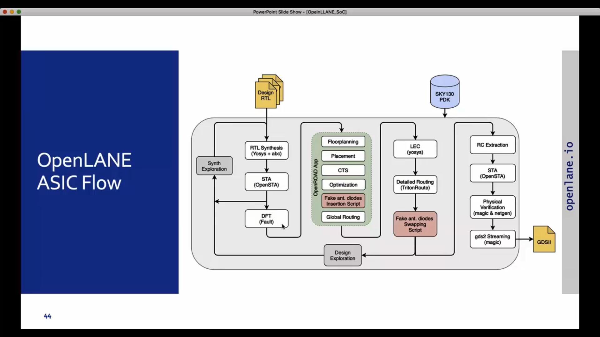

## RTL-to-GDSII sequence

```text
RTL → synthesis → floorplan and I/O placement → PDN and tap cells
    → placement and optimization → CTS → global and detailed routing
    → DRC/connectivity checks → static timing analysis → GDSII
```

Each stage produces inputs for the next one. DEF records physical design
information such as die/core geometry and placement; LEF describes technology and
cell abstracts; Liberty supplies logical and timing models; GDSII stores physical
layout geometry for downstream manufacturing data preparation.

## 1. Synthesis baseline

The Week 3 module synthesizes the `picorv32a` design with OpenLane and the
`sky130_fd_sc_hd` library. The recorded snapshot reports 14,876 standard cells,
including 1,613 `dfxtp_2` flip-flops, with reported library area 147,712.92 units.
The post-synthesis OpenSTA baseline is WNS = -24.89 ns and TNS = -759.46 ns.
Negative slack at this point is a baseline timing violation, not a completed
physical-design result.

## 2. Floorplanning, PDN, and placement

Floorplanning establishes the die, core, rows, and utilization target. In the
documented OpenLane build, `run_floorplan` also performed I/O placement, tap/decap
insertion, and PDN generation. The power-distribution network uses rings, straps,
and standard-cell rails to deliver supply to the design.

The recorded `picorv32a` run used 35% target core utilization. Its DEF reports a
die of approximately 660.805 µm × 671.405 µm (0.44367 mm²). The run inserted 476
endcaps and 5,878 tap cells. Placement recorded 21,699 instances and about 36%
utilization (55% including padding).

| Stage | WNS | TNS |
|---|---:|---:|
| Post-synthesis | -24.89 ns | -759.46 ns |
| Post-placement | -16.57 ns | -388.08 ns |

Placement optimization improved these reported values, but did not close setup
timing. The values belong to the documented run and its constraints.

## 3. Custom cell and physical abstracts

The custom-inverter exercise connects a transistor-level layout to the
Place-and-Route representation:

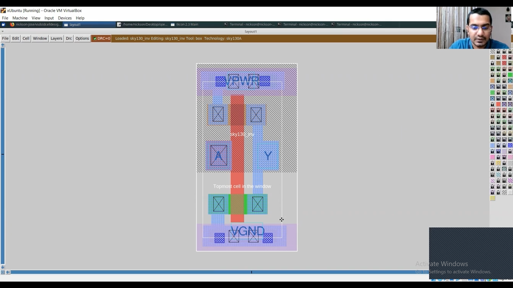

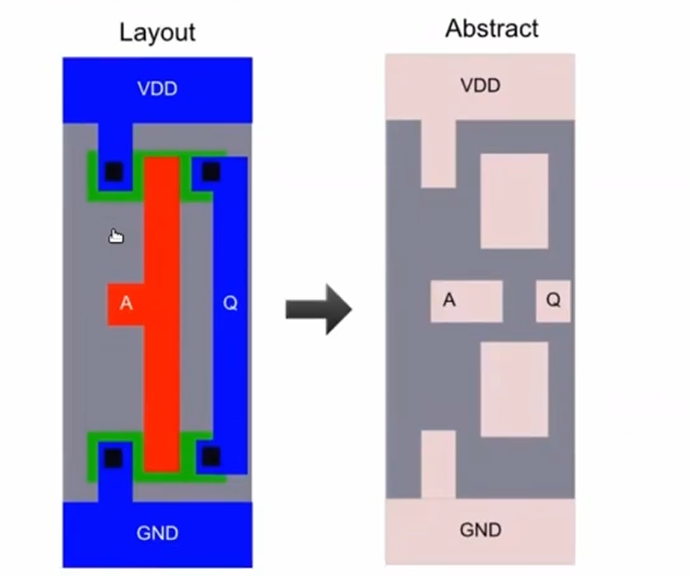

Magic is used for layout, extraction, and custom-cell work. The exercise extracts
the layout to SPICE, simulates and characterizes an inverter, and generates a LEF
abstract. Correct pin names, pin class/use, routing-grid alignment, cell geometry,
and unique macro naming are needed for integration. A LEF abstract by itself does
not supply the timing model required for timing-aware synthesis and STA; that role
belongs to Liberty.

The recorded inverter was 1.380 µm × 2.720 µm. The module flags an unresolved
`Transistor width < 0.42um` DRC warning and an unintended extra `sky130_inv.lef`
in one merge. Those caveats should be resolved before treating the cell as clean
sign-off collateral.

## 4. Setup, hold, and critical-path optimization

Setup checks that data arrives before its capture edge. Hold checks that data does
not arrive too soon after that edge. Positive slack meets the relevant constraint;
negative slack is a violation. WNS is the worst path slack and TNS aggregates the
negative slack over violating paths.

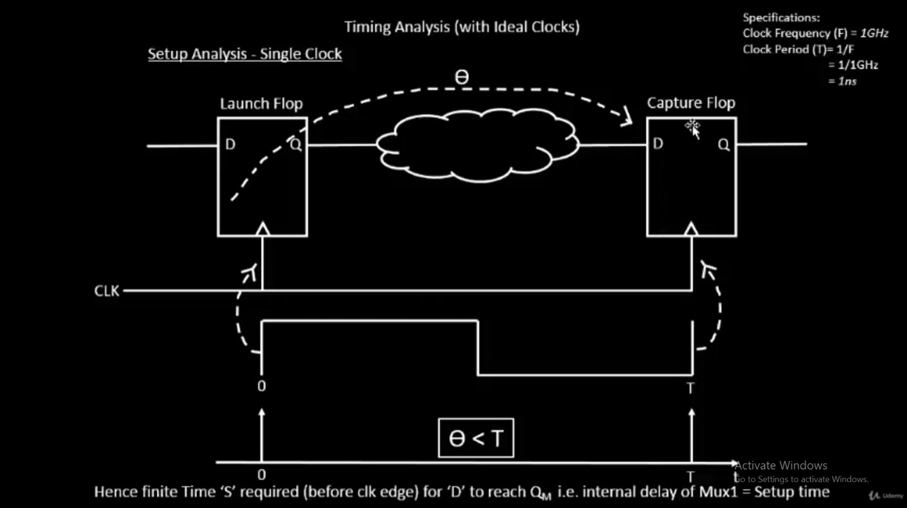

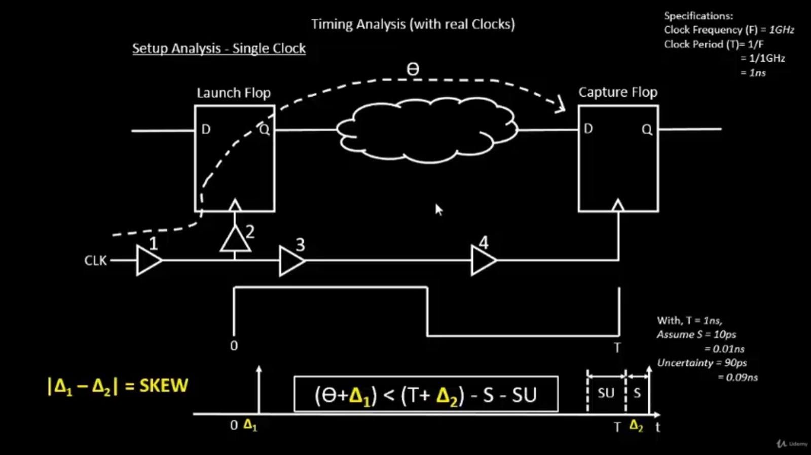

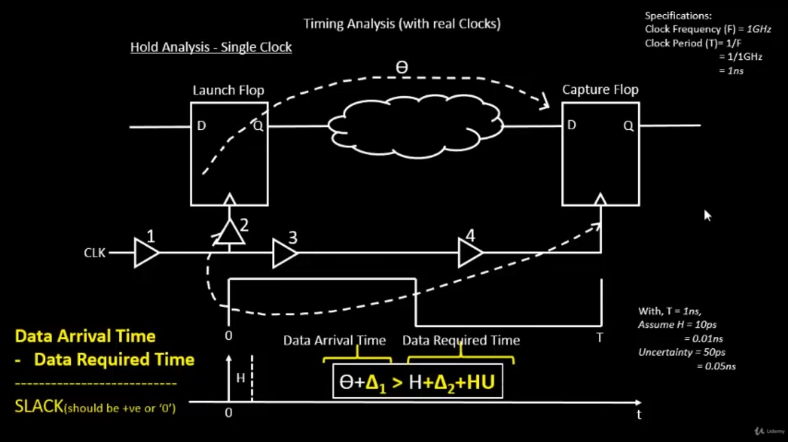

The Module 4 investigation traced a `picorv32a` critical path through roughly 65
serial OR gates. Cell upsizing improved the reported WNS from -22.77 ns to
-12.626 ns, but did not close timing. The changing critical endpoint illustrates
why timing work is iterative and why reducing logic depth can be more effective
than indefinitely increasing cell drive strength.

## 5. Clock-tree synthesis

CTS inserts buffers to distribute the clock to sequential cells while controlling
latency, transition, and skew. Skew is the difference in clock arrival time at
different endpoints; buffer and wire delays both contribute.

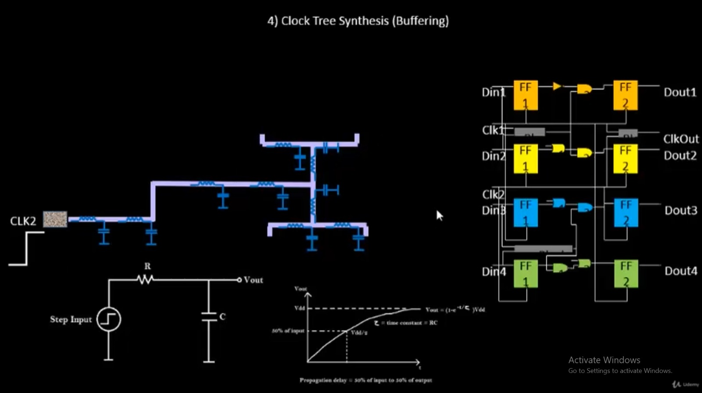

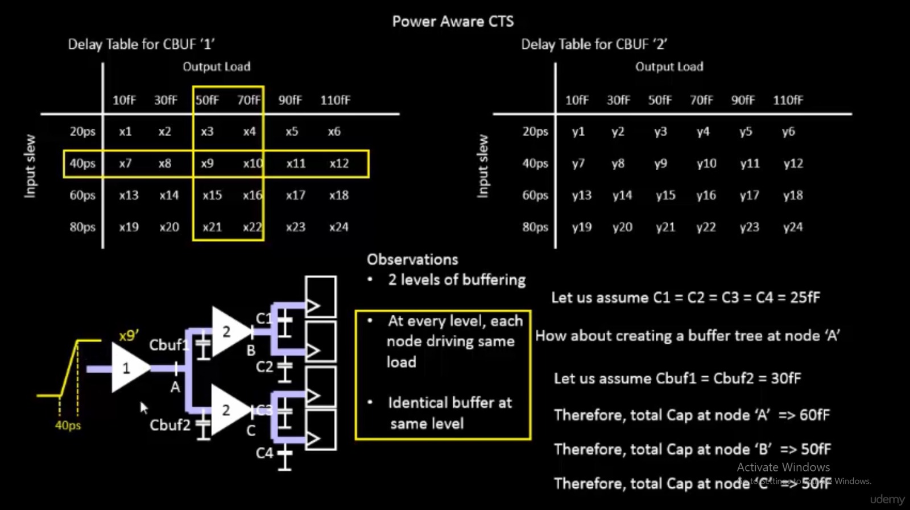

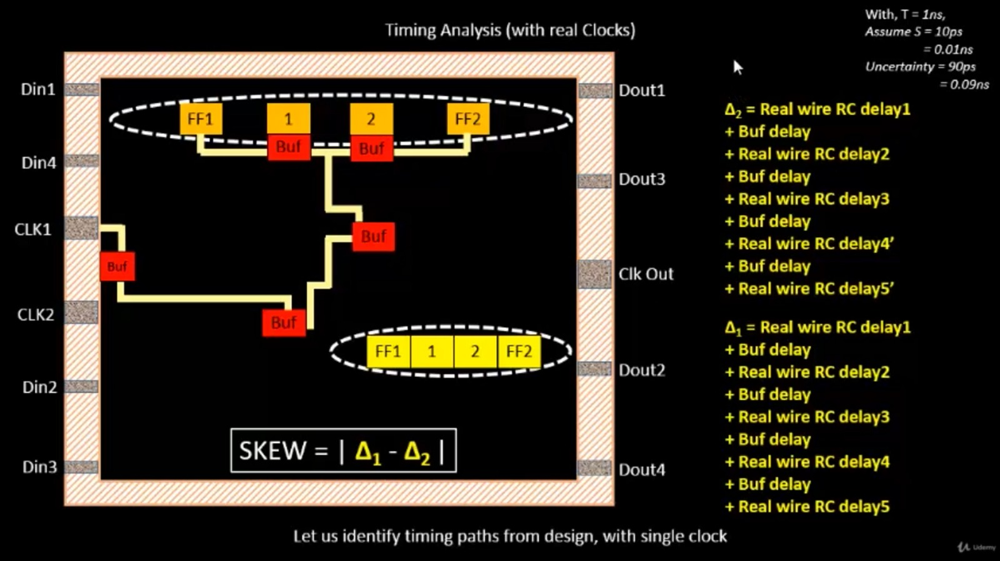

In the recorded `picorv32a` Module 4 run, CTS completed and reported 3.39 ns skew
between the shown clock pins. Post-CTS `run_sta` reported WNS = -13.64 ns and
TNS = -269.12 ns. Clock shielding, crosstalk, and glitching are important theory
topics, but explicit clock-net shielding was not recorded as an implemented step:

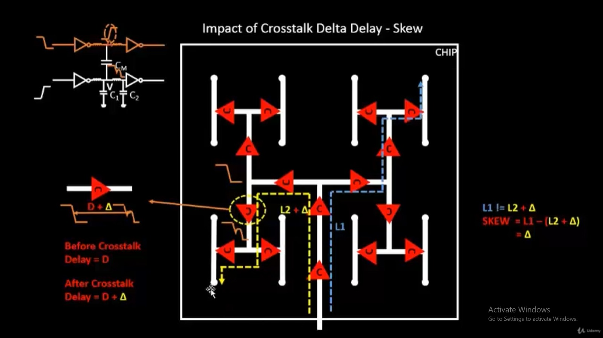

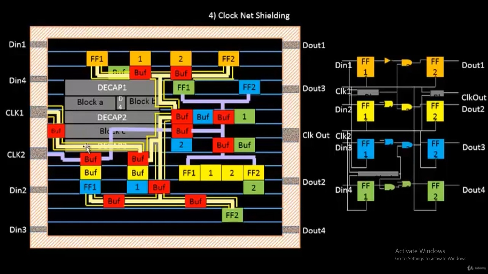

## 6. Routing and post-route checks

Global routing estimates connectivity and generates guides; detailed routing
connects pins on legal tracks with wires and vias while obeying layer and geometric
rules. Lee's maze-routing algorithm illustrates grid-based path search. Modern
routers such as TritonRoute perform detailed routing using routing guides and
panel-based techniques.

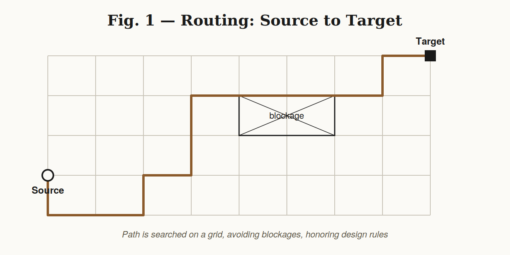

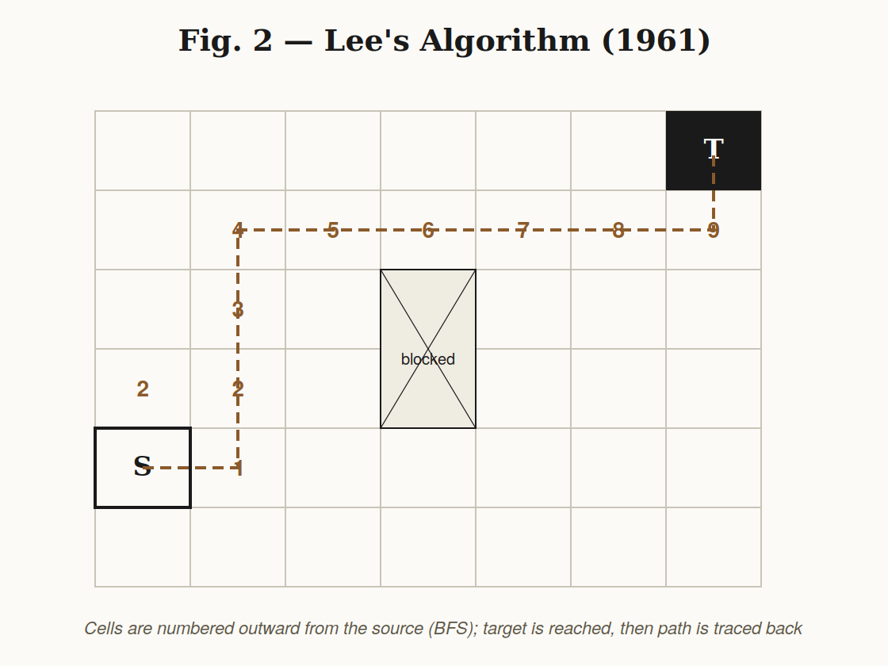

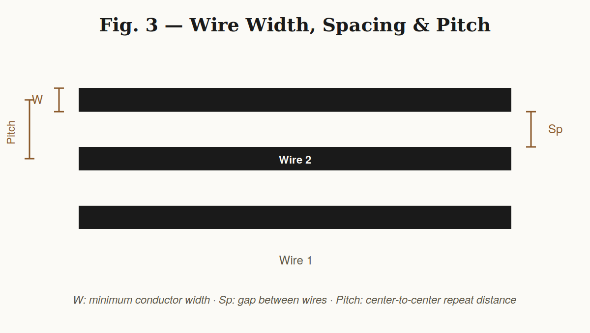

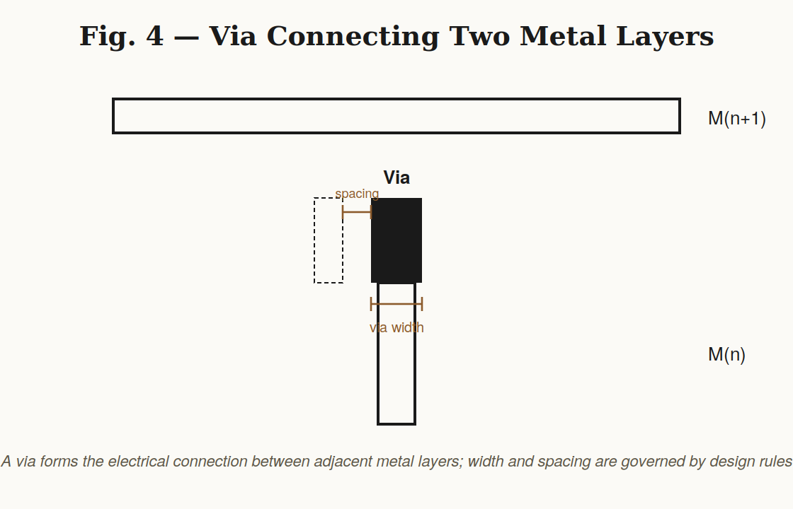

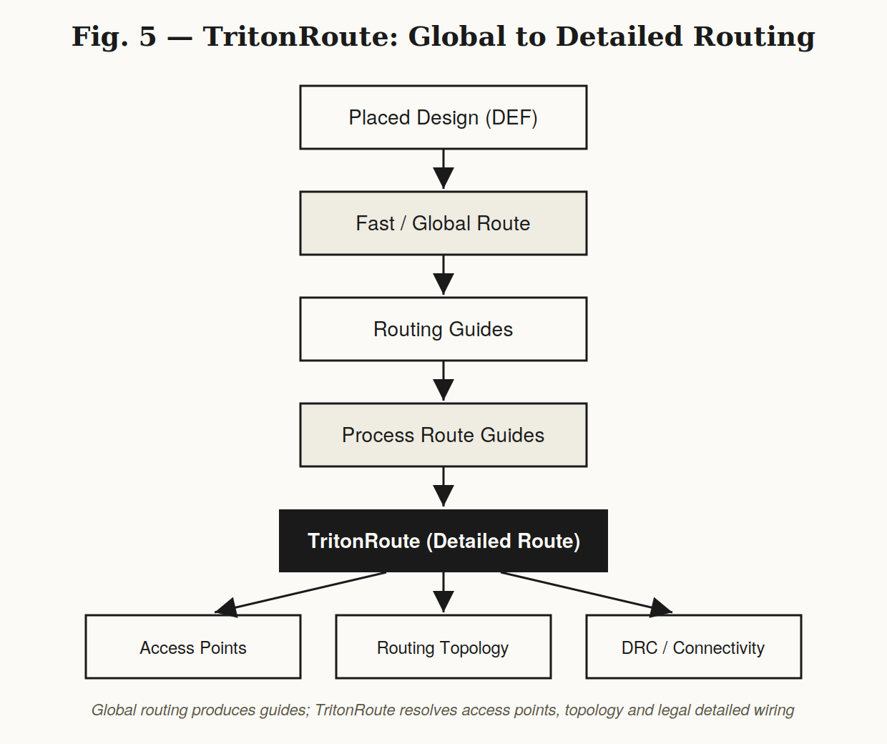

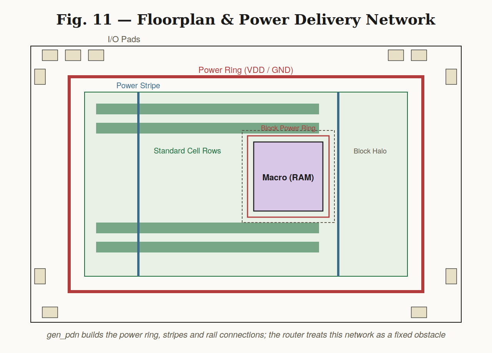

After routing, inspect connectivity, shorts, open nets, antenna checks, DRC, and
post-route timing. Routing completion does not imply sign-off: the detailed route
must pass physical checks, and the timing model must match the extraction and
constraints used for sign-off.

The `picorv32a` Module 5 documentation is a theory walkthrough and does not claim
that the route/sign-off run was completed. The VSD BabySoC report is a separate,
measured routed run; it still has 28 met1 short violations and therefore is not
DRC-clean. See the [BabySoC report](./VSDBabySoC.md) for its conditions and
multi-corner timing results.

## Further reading in this workspace

- [Week 3 synthesis module](../Week3/README.md)
- [Floorplanning, PDN, and placement module](../week3module2/Module2/README.md)
- [Custom inverter design module](../Week3-Module3/Module3/README.md)
- [Custom-cell integration and CTS module](../Week-3-Module4/README.md)
- [Routing theory module](../Week3-Module5/README.md)
- [RTL online course](./RTL_Online_Course.md)
- [VSD BabySoC STA report](./VSDBabySoC.md)
