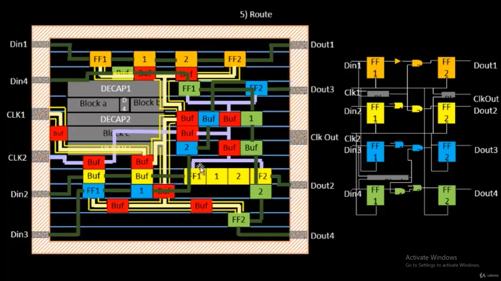

# VSD BabySoC — Static Timing and Physical-Design Report

## Executive summary

This document combines the supplied synthesis-stage and post-route static timing
analysis (STA) reports for VSDBabySoC. The design combines the `rvmyth` RISC-V
core with the AVSD PLL and AVSD DAC macros and targets SKY130 HD standard cells.
Both reports use an 11.00 ns clock target (about 90.91 MHz) and analyze 16
process-voltage-temperature (PVT) corners.

The synthesis-stage report finds setup timing met in 8/16 corners and hold timing
met in all 16. The later routed-database report finds setup timing met in 10/16
corners and hold timing met in all 16. The routed report still records 28 met1
short violations, so the design is **not DRC-clean or ready for sign-off**.


## Source reports and scope

| Source report | Date | What it contains |
|---|---|---|
| `VSDBabySoC_STA_Report.pdf` | 19 September 2026 | OpenSTA results for the synthesized gate-level netlist across 16 SKY130 HD corners |
| `Post_Route_STA_Report_vsdbabysoc_15.pdf` | 10 October 2026 | OpenROAD post-route-database results across 16 corners, plus flow and route-quality measurements |

The PDFs were supplied from `C:\vlsid\tcl19-09-26\` and
`C:\vlsid\10-10-26\`, respectively. Corner-specific paths and some raw flow
outputs are described in the source reports; this document summarizes their
reported results. The synthesis and post-route results are not perfectly
like-for-like because the analyzed netlists and clock/parasitic assumptions differ.

## Design and STA concepts

STA propagates arrival and required times through timing paths without needing
simulation vectors. For setup, data must arrive before the capture edge:

```text
Setup slack = required time - arrival time
```

For hold, data must not arrive too soon after the capture edge:

```text
Hold slack = arrival time - required time
```

Positive slack meets that check; negative slack violates it. Setup is commonly
worst in slow-cell, low-voltage conditions. Hold is commonly stressed by fast-cell,
high-voltage conditions. A single typical-corner pass is not enough to establish
timing across the supported operating range.


## Synthesis-stage STA: 19 September 2026

The first report used OpenSTA 3.1.0 on the synthesized gate-level netlist with an
11.00 ns SDC clock period. The same netlist and constraints were used while
changing the standard-cell Liberty timing corner. The 16 corner runs reported
hold timing met at every corner; setup timing was met at all FF and TT corners
and violated at all eight SS corners.

| Corner | Setup slack (ns) | Setup TNS (ns) | Hold slack (ns) | Setup |
|---|---:|---:|---:|---|
| `ff_n40C_1v95` | +3.9382 | 0.00 | +0.1875 | Met |
| `ff_100C_1v95` | +3.7659 | 0.00 | +0.1960 | Met |
| `ff_n40C_1v76` | +2.8565 | 0.00 | +0.2243 | Met |
| `ff_100C_1v65` | +2.3464 | 0.00 | +0.2491 | Met |
| `ff_n40C_1v65` | +1.9603 | 0.00 | +0.2551 | Met |
| `ff_n40C_1v56` | +0.9378 | 0.00 | +0.2915 | Met |
| `tt_100C_1v80` | +1.0230 | 0.00 | +0.3145 | Met |
| `tt_025C_1v80` | +0.9581 | 0.00 | +0.3096 | Met |
| `ss_n40C_1v76` | -4.7641 | -2,231.95 | +0.5038 | Violated |
| `ss_100C_1v60` | -6.5384 | -3,224.37 | +0.6420 | Violated |
| `ss_n40C_1v60` | -11.1771 | -5,759.85 | +0.6628 | Violated |
| `ss_100C_1v40` | -13.4015 | -8,275.72 | +0.9053 | Violated |
| `ss_n40C_1v44` | -27.3124 | -14,732.52 | +0.9909 | Violated |
| `ss_n40C_1v40` | -33.2707 | -18,474.39 | +1.1249 | Violated |
| `ss_n40C_1v35` | -45.5748 | -24,946.91 | +1.3475 | Violated |
| `ss_n40C_1v28` | -76.8905 | -39,451.23 | +1.8296 | Violated |

The most severe setup corner is `ss_n40C_1v28`: WNS is -76.8905 ns and TNS is
-39,451.23 ns. The large negative TNS indicates widespread violations, rather
than one isolated path. All corners meet hold, and setup is met in the fast and
typical families.

## Post-route STA: 10 October 2026

The second report used OpenROAD v2.0-25794, the routed database `5_route.odb`,
propagated clocks, and an 11.0 ns period. It analyzed the same 16 named
standard-cell corners. This report states that wire RC parasitics were estimated
from global routing with the platform `setRC.tcl`; it did not use SPEF extracted
from detailed routing.

| Corner | Setup slack (ns) | Setup TNS (ns) | Hold slack (ns) | Min period (ns) | Fmax (MHz) | Setup |
|---|---:|---:|---:|---:|---:|---|
| `ff_100c_1v65` | +7.2474 | 0.00 | +0.2615 | 3.75 | 266.48 | Met |
| `ff_100c_1v95` | +8.1128 | 0.00 | +0.2067 | 2.89 | 346.36 | Met |
| `ff_n40c_1v56` | +5.9962 | 0.00 | +0.3056 | 5.00 | 199.85 | Met |
| `ff_n40c_1v65` | +6.7210 | 0.00 | +0.2693 | 4.28 | 233.70 | Met |
| `ff_n40c_1v76` | +7.3479 | 0.00 | +0.2376 | 3.65 | 273.82 | Met |
| `ff_n40c_1v95` | +8.0564 | 0.00 | +0.1998 | 2.94 | 339.72 | Met |
| `ss_100c_1v40` | -3.4532 | -583.34 | +0.9219 | 14.45 | 69.19 | Violated |
| `ss_100c_1v60` | +1.2683 | 0.00 | +0.6574 | 9.73 | 102.76 | Met |
| `ss_n40c_1v28` | -28.2831 | -14,827.03 | +1.7165 | 39.28 | 25.46 | Violated |
| `ss_n40c_1v35` | -16.0734 | -7,001.72 | +1.3140 | 27.07 | 36.94 | Violated |
| `ss_n40c_1v40` | -10.7110 | -3,705.87 | +1.1194 | 21.71 | 46.06 | Violated |
| `ss_n40c_1v44` | -7.6047 | -2,125.70 | +0.9896 | 18.60 | 53.75 | Violated |
| `ss_n40c_1v60` | -0.5273 | -13.45 | +0.6702 | 11.53 | 86.75 | Violated |
| `ss_n40c_1v76` | +2.7816 | 0.00 | +0.5008 | 8.22 | 121.68 | Met |
| `tt_025c_1v80` | +6.1344 | 0.00 | +0.3245 | 4.87 | 205.52 | Met |
| `tt_100c_1v80` | +6.2103 | 0.00 | +0.3269 | 4.79 | 208.78 | Met |

Ten corners meet setup and all 16 meet hold. The worst routed setup result is
`ss_n40c_1v28` at -28.2831 ns, with TNS -14,827.03 ns and an estimated minimum
period of 39.28 ns. Its reported Fmax is 25.46 MHz. These numbers are corner- and
constraint-specific, not a general guarantee of operating frequency.

At the nominal `tt_025c_1v80` corner, the report gives +6.1344 ns worst setup
slack and +0.3245 ns worst hold slack. The example worst setup path ends at
`CPU_Xreg_value_a4[9][18]`, in the register-file endpoint family.

## Physical-design results recorded by the post-route report

The flow summary describes an OpenROAD-flow-scripts run for `sky130hd/vsdbabysoc`
with a 2000 µm × 2000 µm die. The report records:

| Stage / metric | Reported result |
|---|---|
| Synthesis standard-cell area | 53,019.6 µm²; macro area is unknown in Yosys |
| Sequential cell area | 22,901.96 µm² (43.20%) |
| Floorplan | Die 2000 × 2000 µm; core from (20,20) to (1990,1990) µm |
| Fixed macros | DAC at (100.225, 100.105) µm; PLL at (1700.01, 100) µm |
| Final placement | 48,747 instances; 724,388 µm² design area; 19% utilization |
| Clock tree | 1,144 sinks; 112 `clkbuf_16` buffers; reported setup skew 0.21 ns |
| Detailed route | 64 iterations; 237,296 µm wire length; 50,061 vias |
| Antenna checks | 0 net and 0 pin violations |
| Detailed-route shorts | 28 unresolved met1 short violations |

The report's first-run typical-corner stage table gives +6.08 ns setup slack at
placement and +6.04 ns after CTS; the final routed run gives +6.1344 ns. Those
stage data are not all from the same final run, as the report explicitly notes.
The final route remained at 28 met1 shorts after the 64-iteration limit. The
design is therefore not DRC-clean.




The routed-layout illustration above is a theory image from the workshop, not
proof that this BabySoC run passed routing sign-off.

## Interpreting the synthesis-to-route comparison

Across the reports, setup-violating corners decrease from 8 to 6, and the worst
reported slack improves from -76.8905 ns to -28.2831 ns. The worst TNS improves
from -39,451.23 ns to -14,827.03 ns. This should not be attributed to routing
alone: the later report notes that the compared netlists differ, clock treatment
changes from ideal to propagated, and the parasitics are estimated. Treat this as
a comparison of the two recorded snapshots, not a controlled experiment isolating
the effect of routing.

The PVT trend is also important. Setup slack falls rapidly as voltage decreases
in the SS family, particularly below about 1.6 V. At `ss_n40c_1v60`, slack is
-0.5273 ns; at `ss_n40c_1v76`, it is +2.7816 ns. The low-voltage corner is a
material timing risk if operation in that range is required. Conversely, the
fastest-corner hold slack remains positive in the report, with the minimum
reported value +0.1998 ns.

## Recommended next steps

1. Resolve the 28 met1 short violations and rerun detailed-route DRC.
2. Confirm the intended operating voltage and temperature range, then target all
   required SS setup corners rather than only the typical corner.
3. Repair or restructure critical setup paths at the failing SS corners; rerun
   timing after each netlist/constraint change.
4. Use extracted detailed-route parasitics for final STA rather than the
   global-routing estimate used in this report.
5. Re-run the full multi-corner setup and hold checks on the final DRC-clean
   database and document tool versions, constraints, libraries, and outputs.

## Related documents and theory

- [Physical-design online course](./PD_Online_Course.md)
- [RTL online course](./RTL_Online_Course.md)
- [Setup timing theory](../Week-3-Module4/theory_images/theory_02_setup_analysis_ideal_clock.png)
- [Real-clock setup theory](../Week-3-Module4/theory_images/theory_08_setup_analysis_real_clock.png)
- [Real-clock hold theory](../Week-3-Module4/theory_images/theory_09_hold_analysis_real_clock.png)
